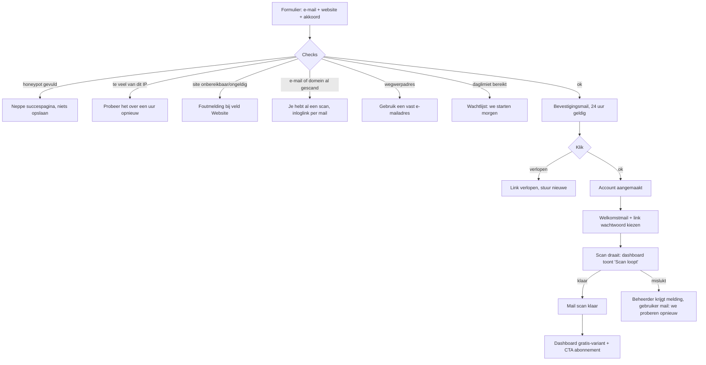

# Promopagina GEO-scan op jpwebcreation.nl

Status: ontwerp + conceptteksten, geen code. Bouwt voort op `ux-plan.md`, `kleurplan.md` en `acties-plan.md`.
Repo `JorisPaarde/jpweb` is alleen gelezen (`AGENTS.md`, `CONTEXT.md`, `index.html`, `styles.css`, `contact.php`, `privacyverklaring/`).
De tool is site-onafhankelijk: elke site kan een gratis scan doen. Rollen zijn generiek: **eigenaar** (wie de scan aanvraagt) en **beheerder** (JP Web Creation).

## 0. Inpassing in de site
- **Route:** `/ai-vindbaarheid/`, als statische HTML naast `/digitale-opname/`.
  - Hij komt in `sitemap.xml` en in het menu als "AI-vindbaarheid".
  - Er komt een link vanaf de homepage (bij tools), op dezelfde manier als Digitale Opname en AI.
  - Het formulier post naar een nieuw PHP-endpoint (`/ai-scan.php`), naar het patroon van `contact.php`:
    - een korte PHP-sessie voor foutherstel van maximaal 10 minuten;
    - geen formulierwaarden in de URL;
    - de honeypot en privacy-akkoord worden nooit hersteld;
    - `aria-describedby` per fout en focus op het eerste foute veld.
- **Stijl:** de merkvariabelen uit `styles.css`: `--ink #18201d`, `--muted #5e6862`, `--paper #fbfaf6`, `--mist #eef1ec`, `--green #315f4f`, `--green-dark #15392f`, `--amber #e7ad52`, `--coral #a84832`. Gebruik dezelfde typografieschalen (`--type-hero`, `--type-section`) en `.section`/`.section-heading`.
  - Berekend contrast: wit op `--green` 7.29; `--green` op `--paper` 6.98; `--ink` op `--paper` 15.92; `--muted` op `--paper` 5.54.
  - De primaire knop is wit op `--green`. Amber en coral komen niet in de tekst (coral is op `--paper` 5.53, maar te veel signaal).
- **Herhaalde items** (de drie probleempunten, de stappen) krijgen de bestaande `.reveal-card`. Kopjes, het formulier en de FAQ blijven direct zichtbaar. Na een CSS- of JS-wijziging gaat `?v=` in elke HTML omhoog.
- **Toon (CONTEXT.md):** rustig, direct, ik-vorm voor Joris, geen hype, geen verzonnen resultaten.
  - "Sutherland" betekent hier: anders kaderen en eerlijk zijn als overtuiging, niet harder roepen.
  - Waar een claim niet aantoonbaar is, staat hij als vraag.
- **Merken:** volgens het kleurplan (§7) staat er "gemeten in". Perplexity en OpenAI krijgen alleen een klein symbool. **Google staat alleen als tekst**, zonder logo. Er komt een merkvoetnoot.
  - De vraag in de kop noemt "ChatGPT, Perplexity en Google AI". Dat mag als platte tekst.
  - Wat we echt meten staat in de FAQ: Perplexity en ChatGPT (API) altijd, het echte ChatGPT en Google AI-overzichten via DataForSEO waar beschikbaar. De configuratie daarvan is nog tegenstrijdig (zie `geo-plan-voor-review.md`). Claim Google pas op de pagina als die meting stabiel draait.

## 1. Paginastructuur (390px eerst)

Er is **één primaire CTA:** "Doe de gratis scan". Hij springt naar het formulier (`#scan`). Elke andere knop is een tekstlink.

### 1.1 Hero
- **H1:** **Noemt ChatGPT jouw bedrijf, of je concurrent?**
- **Lead:** Steeds meer mensen vragen een AI-assistent om een bedrijf aan te raden, in plaats van zelf te zoeken. Dan krijg je geen tien blauwe links, maar een paar namen. Sta jij daartussen? De meeste ondernemers hebben geen idee. Ik meet het voor je.
  - "Steeds meer" is algemeen en wordt hier niet als cijfer geclaimd. Wil Joris dat liever als vraag, dan: "Vraag jij ChatGPT weleens om een tip?"
- **CTA:** [Doe de gratis scan]
- **Microcopy onder de knop:** Gratis, één keer per bedrijf. Je hebt alleen je e-mailadres en je website nodig.
- **Op 390px:** H1 ±2.4rem, de knop over de volle breedte, 48px hoog. Geen carrousel of beeld boven de knop.

### 1.2 Reframe: "Je bent niet onvindbaar. Je bent niet genoemd."
- **H2:** In Google sta je op plek 4. In een AI-antwoord bestaat plek 4 niet.
- **Tekst:** Een zoekmachine laat een lijst zien. Een AI-assistent kiest. Wie niet genoemd wordt, verliest geen positie: die doet gewoon niet mee. Daar merk je niets van, want niemand belt om te zeggen dat hij jou níét heeft gevonden.
- Er komen drie `.reveal-card`'s:
  1. **Je ziet het niet.** Er is geen teller die laat zien hoe vaak AI je overslaat.
  2. **Je concurrent misschien wel.** AI noemt vaak dezelfde paar bedrijven. Zijn dat jouw concurrenten?
  3. **Het verandert.** Elke week kunnen de antwoorden anders zijn. Eén keer kijken zegt weinig.

### 1.3 Live voorbeeld: Stunten met Plinten (zie §1.9 voor de regels)
- **H2:** Zo ziet een meting eruit
- **Kaart** (kleurplan-stijl, `#fff` op `--paper`), ingevuld vanuit `stuntenmetplinten/weekly.jsonl` (laatste regel met `status: ok` en `complete: true`):
  - Kop: **Stunten met Plinten** · stuntenmetplinten.nl · `gemeten op {measured_at, bijv. maandag 12 oktober}`
  - Groot: **38 van 50 antwoorden** (`mentioned` van `answers`) + klein **74%** (`pct`)
  - Badge per kleurplan: **✓ Goed** (`#0f7b6c`, wit, 5.16:1). Als de band over 60% gaat: "Goed, rond de grens".
  - Regel: `Waarschijnlijk tussen 56% en 91%` (`band`).
  - Per bron: `Perplexity: 25 van 30` · `ChatGPT (via OpenAI): 13 van 20` (`per_assistant`), met een klein symbool volgens het kleurplan.
  - Trend: alleen bij ≥ 2 complete weken met dezelfde vragenset: `Vorige week {pct_vorig}%`. Bij 1 week: "Trend volgt na meer metingen."
  - Voetregel: `We stelden {questions} vragen die klanten van een plintenbedrijf stellen. Wordt elke week automatisch bijgewerkt.`
- **Tekst onder de kaart:** Dit is een echte klant, met toestemming. Het cijfer is niet gekozen omdat het mooi is: het wordt elke maandag opnieuw gemeten en komt hier ongewijzigd te staan, ook als het zakt.
- **Tekstlink:** Zo ziet het dashboard eruit → een statische screenshot van het dashboard, geen login.

### 1.4 Benchmark (verborgen tot de minimum-n gehaald is, zie §1.9)
- **H2:** Zo vaak noemt AI een lokaal bedrijf
- **Bij voldoende data:** `Bij de {n_bedrijven} bedrijven die we meten, noemt AI het bedrijf zelf in {mediaan}% van de antwoorden (de helft zit tussen {p25}% en {p75}%).`
- **Bij te weinig data** (de stand bij de lancering): het blok wordt een vraag: **"Zit jij boven of onder het gemiddelde? Dat weten we pas als genoeg bedrijven gemeten zijn. Jouw scan telt mee (anoniem)."**

### 1.5 Wat je krijgt bij de gratis scan
- **H2:** Wat de gratis scan laat zien
- Een checklist (gewone `ul`, iconen uit het kleurplan):
  - ✓ Hoe vaak AI-assistenten je noemen, als "X van Y antwoorden".
  - ✓ Welke bedrijven AI in plaats van jou noemt.
  - ✓ Eén eerste verbeteridee, gebaseerd op wat er nu op je site staat.
  - ○ Geen trend: daarvoor is één meting te weinig (die zit in het abonnement).
- **Eerlijkheidsregel** (costly signal): Ik vertel je ook als het laag is. Een laag getal is geen mislukking. Het is het beginpunt.

### 1.6 Hoe het werkt (4 stappen, `.reveal-card`)
1. Vul je e-mailadres en website in.
2. Bevestig je e-mailadres.
3. Je krijgt inloggegevens voor je eigen dashboard.
4. De scan draait; je krijgt een mail als hij klaar is.

### 1.7 Formulier `#scan`
- **H2:** Doe de gratis scan
- **Velden:**
  - E-mailadres: `type=email`, `autocomplete=email`, verplicht.
  - Website: `type=url` met `inputmode=url`, placeholder "jouwbedrijf.nl", verplicht.
  - Honeypot: een veld `bedrijfsfax`, visueel verborgen, `tabindex=-1`, `autocomplete=off`.
  - Een checkbox (niet aangevinkt): "Ik ga akkoord dat JP Web Creation mijn e-mailadres en website gebruikt voor deze scan, zoals beschreven in de [privacyverklaring](/privacyverklaring/)."
  - Een tweede, optionele checkbox (niet aangevinkt): "Mail me af en toe wat ik over mijn AI-vindbaarheid kan verbeteren." *(voorlopig niet tonen, zie open vragen)*
- **Knop:** [Doe de gratis scan] (de enige primaire knop, 48px).
- **Onder de knop:** Je ontvangt eerst een mail om je adres te bevestigen. Pas daarna starten we de scan.

### 1.8 FAQ (`.faq-list`, `
`)
- **Welke AI-assistenten meet je?** Perplexity en ChatGPT (via de OpenAI-API), en waar beschikbaar het echte ChatGPT en de AI-overzichten van Google. De ChatGPT-app en Google zelf meten we niet altijd op dezelfde manier als een gebruiker ze ziet. Dat staat in je dashboard bij "Hoe we meten".
- **Welke vragen stel je?** Vragen die jouw klanten waarschijnlijk stellen, op basis van wat je site aanbiedt. Je ziet ze allemaal in je dashboard.
- **Is één scan betrouwbaar?** Het is een eerste indruk. Bij {answers} antwoorden kan het getal een paar procent verschuiven door toeval. Daarom meet het abonnement elke week.
- **Wat kost het daarna?** Niets, tenzij je zelf kiest voor wekelijkse metingen (zie §7).
- **Wat doe je met mijn gegevens?** Kort antwoord + link naar de privacyverklaring (§4).
- Merkvoetnoot (kleurplan §7).

### 1.9 Besluit live-blok: wat verkoopt eerlijk?

| Optie | Verkoopt? | Eerlijk/haalbaar nu | Besluit |
|---|---|---|---|
| Eigen score JP Web Creation | Nee: het getal is laag (7 van 50, ✕ Zwak) | Wel eerlijk | **Vervalt** (besluit Joris) |
| **Stunten met Plinten, met naam** (38 van 50, ✓ Goed) | Ja: een echt, herkenbaar lokaal bedrijf met een concreet getal | Echte data, wekelijks; toestemming volgens Joris | **Primair live-blok** |
| (a) Anonieme "lokale vakman: van X naar Y" | Sterk zodra er een echte stijging is | Er is nu geen vóór/na: er is 1 week data en geen gemeten effect | Later toevoegen: pas na een **gemeten** effect (acties-plan: "Effect gemeten", ≥ 10 pp buiten de onzekerheid) en met schriftelijke toestemming |
| (b) Benchmark over alle gemeten bedrijven | Sterk (verliesaversie: "zit jij eronder?") | Er zijn nu maar 2 bedrijven, dus niet zinvol | Tonen vanaf **≥ 20 bedrijven** met een complete meting in de laatste 4 weken. Daarvoor: de vraagvariant |
| (c) Teller gedane scans | Zwak bij lage aantallen ("3 scans" schrikt af) | Echt telbaar | Pas vanaf **≥ 100 bevestigde scans**, als kleine regel onder de CTA: "Al {n} bedrijven lieten hun AI-vindbaarheid meten." Daarvoor niet tonen |

**Stunten met Plinten: regels**
- **Bron:** de laatste regel in `weekly.jsonl` met `status ok` en `complete true`. Alleen getallen 1-op-1 (`mentioned`, `answers`, `pct`, `band`, `per_assistant`, `measured_at`). Een build-stap schrijft ze elke maandag na de meting naar `/ai-vindbaarheid/voorbeeld.json`. De statische pagina leest dat bestand; zonder JS staat er de laatst gebouwde HTML.
- **Minimum:** ≥ 40 antwoorden in de meting, anders wordt de vorige complete week getoond.
- **Meting ontbreekt of is incompleet:** toon de laatste complete meting met de datum. Is die ouder dan 14 dagen, dan staat er het label "◷ Laatste meting van {datum}".
- **Ouder dan 28 dagen:** het blok verdwijnt en wordt de vraagvariant (zie hieronder).
- **Niveau zakt:**
  - Naar Matig: blijven tonen met "! Matig". Dat is eerlijk en het past bij de belofte "ook als het zakt".
  - Naar Zwak (2 weken achter elkaar): het blok gaat terug naar de vraagvariant en de beheerder krijgt een melding. Een zwak voorbeeld zonder uitleg verkoopt niet en kan de klant schaden.
  - Niet stilletjes een betere week kiezen: altijd de laatste complete meting of niets.
- **Toestemming:** Joris zegt dat het mag. Leg die schriftelijk vast (een mail van de eigenaar van Stunten met Plinten, met datum, waarvoor: naam + getallen op jpwebcreation.nl, intrekbaar), en bewaar die in `stuntenmetplinten/consent.json` (`given_by, date, scope, revocable: true`). Wordt de toestemming ingetrokken, dan valt het blok binnen 1 werkdag terug op de vraagvariant.
- **Vraagvariant** (fallback): **"Hoe vaak noemt AI jouw bedrijf? Bij Stunten met Plinten meten we het elke week. Wil je weten waar jij staat?"** + CTA. Er staat geen getal in.

**Launch-stand (12-10):** 2 gemeten bedrijven en 0 publieke scans.
- Het SMP-blok staat aan: W42, 38/50, ✓ Goed, band 56–91, trend volgt na meer metingen.
- De benchmark staat in de vraagvariant.
- De teller is verborgen.
- Er is geen "van X naar Y" omdat er nog geen effect gemeten is.

## 2. Flow

1. **Formulier versturen.** Server-side checks in deze volgorde: honeypot → rate limit IP → geldig e-mailadres → site bereikbaar en normaliseren → al gescand (e-mail/domein) → wegwerpadres → daglimiet. Daarna wordt een signup opgeslagen met `status=onbevestigd` en gaat de bevestigingsmail eruit.
2. **Bevestigingsmail** (double opt-in) met een eenmalige link, 24 uur geldig.
3. **Klik op de bevestigingslink:** de checks worden opnieuw gedaan (al gescand, daglimiet), dan wordt `status=bevestigd`.
4. **Account wordt automatisch aangemaakt:** gebruikersnaam = e-mailadres, plus een eenmalige link om zelf een wachtwoord te kiezen (geen wachtwoord in de mail).
5. **Mail met inloggegevens/welkom.**
6. **De gratis scan draait:** snapshot, vragen en 1 meting (50 antwoorden).
7. **Mail "scan klaar"** → het eigen dashboard in kleurplan-stijl (gratis-variant, zie §7).

**Staten en meldingen per stap** (letterlijk):

| Situatie | Wat je ziet |
|---|---|
| Na versturen (ok, en ook bij een honeypot) | **Check je mail.** We hebben een bevestigingslink gestuurd naar {e-mail}. Zie je niets? Kijk in je spam of [stuur opnieuw]. |
| Ongeldig e-mailadres | Bij het veld: Dit lijkt geen geldig e-mailadres. Controleer het nog even. |
| Ongeldige/onbereikbare site | Bij het veld: We kunnen deze website niet bereiken. Klopt het adres? Probeer bijvoorbeeld "jouwbedrijf.nl". |
| Site blokkeert ons (403/robots) | We mogen deze website niet lezen. Daardoor kunnen we geen goede vragen maken. Neem contact op als je denkt dat dit niet klopt. |
| Al gescand | Voor deze website of dit e-mailadres is al een gratis scan gedaan. We sturen een inloglink naar het e-mailadres van die scan. *(Het e-mailadres wordt niet getoond, om niet te verraden wie er gescand heeft.)* |
| Wegwerpadres | Gebruik een e-mailadres dat je blijft lezen. Je inloggegevens en uitslag komen daar terecht. |
| Daglimiet bereikt | Vandaag zijn alle gratis scans bezet. Bevestig je adres; je scan start dan automatisch op de eerstvolgende dag met ruimte. Je krijgt een mail. |
| Te veel pogingen (IP) | Je hebt het formulier een paar keer achter elkaar verstuurd. Probeer het over een uur opnieuw. |
| Bevestigingslink verlopen | Deze link is verlopen (hij is 24 uur geldig). [Stuur een nieuwe link] |
| Link al gebruikt | Je adres is al bevestigd. [Naar je dashboard] |
| Scan mislukt | In het dashboard: De scan is niet gelukt. Ik kijk ernaar en start hem opnieuw. Je krijgt een mail als hij klaar is. |

## 3. Misbruikbescherming

| Maatregel | Regel | De gebruiker ziet |
|---|---|---|
| 1 scan per e-mailadres | Hash van het genormaliseerde adres (kleine letters; bij Gmail punten en `+tag` weg) | "Al gescand" |
| 1 scan per domein | Normaliseren: kleine letters, `www.` en protocol weg, pad weg, redirects volgen (final host), IDN naar punycode, registreerbaar domein via de public suffix list (`shop.x.nl` → `x.nl`) | "Al gescand" |
| Daglimiet | Maximaal [aantal door beheerder] bevestigde scans per dag in totaal; voorlopig 20. Met ±€0,30–0,60 per scan (geo-plan) is dat maximaal ±€12 per dag. | Wachtlijst |
| Honeypot | Gevuld → stil weggooien | Dezelfde "Check je mail"-pagina, zodat bots niets leren |
| Rate limit per IP | 5 verzendingen per uur, 20 per dag; alleen in het geheugen of een tijdelijk bestand, 24 uur bewaard | "Te veel pogingen" |
| Wegwerpadressen | **Besluit: weigeren** op basis van een open lijst (bijv. disposable-email-domains), wekelijks bijgewerkt. Een scan kost geld en het dashboard is persoonlijk. | Vriendelijke melding |
| Double opt-in | Er wordt niets gescand zonder bevestiging | — |
| Domein ≠ e-maildomein | Toegestaan (veel mkb'ers gebruiken Gmail), maar het wordt gelogd. Bij misbruik kan de beheerder het handmatig blokkeren. | — |
| Bekende grote merken / overheid | Optionele blocklist van domeinen die we niet gratis scannen | "Voor deze website doen we geen gratis scan. Neem contact op." |

## 4. AVG (juridische toets aanbevolen)

> Let op: dit zijn concepten op basis van de feiten in dit plan. Laat ze nakijken door iemand met juridische kennis voordat ze live gaan. Er staan bewust geen juridische claims in, behalve wat we feitelijk doen.

**Toevoeging aan `/privacyverklaring/`** (een nieuwe paragraaf "AI-vindbaarheidsscan"):

> **AI-vindbaarheidsscan**
> Als je een gratis scan aanvraagt, verwerk ik je e-mailadres, de website die je opgeeft, het tijdstip van je aanvraag en bevestiging, en een tijdelijk technisch kenmerk van je verbinding (IP-adres) om misbruik te voorkomen.
>
> Waarom: om je adres te bevestigen, je een account en inloggegevens te sturen, de scan uit te voeren en je de uitslag te laten zien. Het IP-adres gebruik ik alleen om te voorkomen dat het formulier massaal wordt misbruikt.
>
> Hoe lang:
> - Een aanvraag die je niet bevestigt, verwijder ik na 7 dagen.
> - IP-gegevens verwijder ik na 24 uur.
> - Je account en scanuitslag bewaar ik tot je ze laat verwijderen, of tot 12 maanden na je laatste login.
> - Om te voorkomen dat dezelfde website of hetzelfde adres opnieuw een gratis scan aanvraagt, bewaar ik daarna alleen een onomkeerbare code (hash) van je e-mailadres en de domeinnaam.
>
> Wie verwerkt dit:
> - JP Web Creation.
> - De hostingpartij van jpwebcreation.nl.
> - De mailverzender voor de bevestigings- en inlogmails.
> - Voor de scan zelf stuur ik **alleen openbare informatie** naar AI-diensten (zoals Perplexity en OpenAI, via OpenRouter, en DataForSEO voor Google- en ChatGPT-resultaten): vragen die klanten zouden kunnen stellen, gebaseerd op de openbare inhoud van je website. **Je e-mailadres en je IP-adres gaan niet naar deze diensten.**
>
> Je rechten: je kunt je gegevens inzien, laten aanpassen of laten verwijderen via info@jpwebcreation.nl of met de knop "Verwijder mijn account" in je dashboard. Ik verwijder dan je account, je uitslag en je e-mailadres; alleen de hash blijft om dubbele gratis scans te voorkomen.

- *Aannames om te controleren:* de hostingpartij, de mailverzender (welke?), en of het bewaren van de hash na verwijdering mag. De bewaartermijn van 12 maanden is een voorstel.

**Akkoordtekst (checkbox):** "Ik ga akkoord dat JP Web Creation mijn e-mailadres en website gebruikt voor deze scan, zoals beschreven in de privacyverklaring."

**Onbevestigde aanmeldingen:** worden automatisch verwijderd na 7 dagen. De bevestigingslink zelf werkt 24 uur.

## 5. Mailteksten
Ze beginnen met "Hoi,", zijn in ik-vorm (Joris), kort, met lege regels en zonder emoji. Ze eindigen met "Groet," en er staat niets onder.

**Bevestigen**
Onderwerp: Bevestig je e-mailadres voor de AI-scan

> Hoi,
>
> Je vroeg een gratis AI-vindbaarheidsscan aan voor {website}.
>
> Bevestig eerst je e-mailadres, dan maak ik je account aan en start de scan:
> {bevestigingslink}
>
> De link werkt 24 uur. Heb jij dit niet aangevraagd? Dan hoef je niets te doen; de aanvraag wordt na 7 dagen vanzelf verwijderd.
>
> Groet,

**Welkom / inloggegevens**
Onderwerp: Je account voor de AI-scan staat klaar

> Hoi,
>
> Je e-mailadres is bevestigd. Je account staat klaar.
>
> Inloggen doe je met dit e-mailadres. Kies eerst een wachtwoord via deze link (24 uur geldig):
> {wachtwoordlink}
>
> Je dashboard: {dashboardlink}
>
> De scan voor {website} is gestart. Ik mail je als de uitslag klaar is.
>
> Groet,

**Scan klaar**
Onderwerp: Je AI-scan voor {website} is klaar

> Hoi,
>
> De scan voor {website} is klaar.
>
> AI-assistenten noemden je in {mentioned} van de {answers} antwoorden.
>
> In je dashboard zie je welke bedrijven ze in plaats van jou noemden, en een eerste idee om dat te verbeteren:
> {dashboardlink}
>
> Het is één meting, dus een eerste indruk. Wil je weten of het beter of slechter gaat? Dan kun je in je dashboard kiezen voor een wekelijkse meting.
>
> Groet,

- De zin met het getal komt 1-op-1 uit de data, zonder oordeel in de mail. Het niveau staat in het dashboard.
- Een mislukte meting stuurt geen "scan klaar"-mail. Dan gaat de foutmelding uit §2 eruit.

## 6. Lege staat "Scan loopt" (dashboard)
- **Kop:** `AI-zichtbaarheid {domein}`
- **Kaart:** ◷ Grijze pill "Scan loopt" (`#5b6475` op `#eef0f3`, 5.22).
- **Tekst:** **"Je scan loopt. We lezen je website, stellen vragen aan AI-assistenten en tellen hoe vaak je genoemd wordt. Je krijgt een mail als het klaar is; je hoeft deze pagina niet open te houden."**
- **Voortgang:** alleen echte stappen als checklist, zonder percentages:
  - ✓ Website gelezen
  - ◷ Vragen worden gesteld ({gedaan} van {totaal})
  - ○ Uitslag
  - Het aantal gedaan/totaal is een echte telling uit de pipeline. Is die er niet, dan staat er alleen de stap.
- **Geen tijdsbelofte.** Pas als de doorlooptijd van ≥ 20 echte scans bekend is: "Meestal klaar binnen {mediaan} minuten."
- **Automatisch verversen:** elke 30 s een kleine statusvraag, met `aria-live="polite"` op de kaart. Na 30 minuten stopt het verversen, met de tekst "Het duurt langer dan normaal. Je krijgt een mail als het klaar is."
- **Wachtlijst** (daglimiet): "Je scan staat in de rij en start op {datum}. Je krijgt een mail."

## 7. Van gratis naar betaald
**Prijs:** er is geen prijs gevonden in de workspace-bestanden. De placeholders zijn `[bedrag door Joris]`. Alleen de meetkosten zijn bekend (±€0,30–0,60 per klant per meting, harde grens €0,60 per week, uit `geo-plan-voor-review.md`).

| | Gratis scan | Eenmalige scan+ | Wekelijks abonnement |
|---|---|---|---|
| Prijs | €0 | `[bedrag door Joris]` eenmalig | `[bedrag door Joris]` per maand, maandelijks opzegbaar `[voorwaarde door Joris]` |
| Metingen | 1 | 1 uitgebreide (bijv. 2 runs, meer vragen) | Elke week |
| "X van Y" + niveau | ✓ | ✓ | ✓ |
| Concurrenten | Top 3 | Top 5–10 | Top 5–10, elke week |
| Trend | — | — | ✓ (na 2 weken; "te vroeg"-regels) |
| Acties | 1 voorbeeldactie | 3 acties met Nu/Wordt | 3 acties per week + effect gemeten |
| Aanpassingslogboek | — | — | ✓ |
| Per vraag/plaats | Alleen de vragenlijst | ✓ | ✓ |

**CTA in het dashboard na de gratis scan** (één blok, onder de uitslag, boven Details):
- **Kop:** **Eén meting is een foto. Wil je de film?**
- **Tekst:** Wat AI antwoordt verandert van week tot week. Met een wekelijkse meting zie je of het beter gaat, welke concurrent opkomt, en krijg je elke week drie concrete verbeteringen voor je eigen site, met wat er nu staat en wat het wordt.
- **Knop:** [Start wekelijkse meting – `[bedrag door Joris]` per maand]
- **Tekstlink:** Liever eerst één uitgebreide scan? (`[bedrag door Joris]`)
- **Eerlijkheidsregel onder de knop:** Een hoger getal kan ik niet beloven. Wel dat je elke week precies ziet waar je staat.
- **Bij ✕ Zwak:** "Je begint laag. Dat betekent ook dat elke verbetering zichtbaar wordt." Geen angsttaal.
- **Bij ✓ Goed:** "Je staat er goed voor. Houd het in de gaten: concurrenten kunnen ook verbeteren." (verliesaversie, maar waar)

## 8. Open vragen (met voorlopige keuze)
1. **Prijs** eenmalig en per maand, en de opzegtermijn. *Voorlopig:* `[bedrag door Joris]`, maandelijks opzegbaar.
2. **Google in de kop** terwijl de DataForSEO-meting nog niet stabiel draait. *Voorlopig:* de kop noemt ChatGPT. De lead en FAQ noemen Google pas zodra die meting stabiel draait.
3. **Toestemming Stunten met Plinten:** schriftelijk vastleggen (`consent.json` + mail). *Voorlopig:* het blok gaat pas live als de mail binnen is.
4. **Daglimiet gratis scans.** *Voorlopig:* 20 per dag.
5. **Wegwerpadressen:** *voorlopig* weigeren.
6. **Marketingmail-checkbox:** *voorlopig* niet tonen. Alleen transactionele mails.
7. **Bewaartermijn account** zonder abonnement. *Voorlopig:* 12 maanden na de laatste login. Daarna verwijderen, alleen de hash blijft.
8. **Welke mailverzender en welke hostingpartij** staan in de privacytekst? *Voorlopig:* opengelaten voor de juridische toets.
9. **Drempels benchmark en teller:** *voorlopig* ≥ 20 bedrijven en ≥ 100 scans.
10. **Route en menunaam:** *voorlopig* `/ai-vindbaarheid/` en "AI-vindbaarheid".
